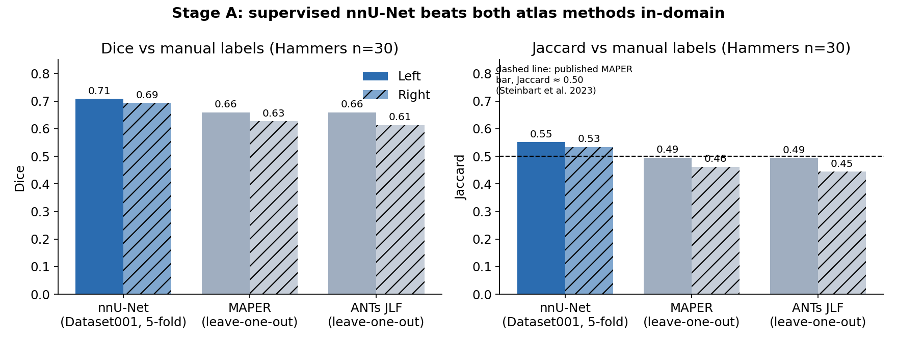

# piriform-ai: training deep-learning models to segment the piriform cortex

[](https://phindagijimana.github.io/piriform-ai/)

**Author:** Philbert Ndagijimana · **Documentation: <https://phindagijimana.github.io/piriform-ai/>**

An end-to-end record of training, evaluating, and stress-testing AI segmentation models for the **piriform cortex** on brain MRI. The documentation site explains the **theory and mathematics** behind every step and walks through the **code** function by function. It also logs each **experiment** as hypothesis, design, result, and decision. Every method choice is tied to a peer-reviewed source.

> **Scope.** Code, methods, aggregate results, and lessons only. There are **no imaging data, labels, model weights, per-subject results, or subject identifiers**. The training data are governed by data-use agreements (ADNI and a private clinical cohort) and stay on-premises.

## The problem in one paragraph

The piriform cortex (PC) is a thin strip of olfactory cortex where the frontal and temporal lobes meet. In temporal lobe epilepsy, removing at least half of it during surgery is associated with much higher odds of seizure freedom ([Galovic et al., 2019](https://doi.org/10.1001/jamaneurol.2019.0204)). It is about **0.5 cm³ per hemisphere**, only 2–3 mm thick, and low in contrast. The only published automatic method, multi-atlas MAPER, agrees with manual tracing at Jaccard ≈ **0.50** ([Steinbart et al., 2023](https://doi.org/10.1002/hbm.26274)). The question was whether a trained deep-learning model can beat that, and whether it still works on other scanners.

## Headline results

| Question | Answer | Evidence |
|---|---|---|
| Can a supervised 3D U-Net learn PC from 30 labelled brains? | **Yes.** nnU-Net beats both atlas methods on the same held-out brains. | Dice 0.71 / 0.69 (L/R) vs MAPER 0.66 / 0.63 and JLF 0.66 / 0.61 |
| Does it transfer to a second labelled site (ADNI)? | **No.** Every variant stayed near Dice 0. The branch was stopped at a threshold fixed before the results. | ADNI 0.02–0.04 while Hammers stayed at 0.68 |
| Does it transfer to an unlabelled clinical cohort? | **Partly.** It works only once the crop is centred on the right anatomy and brain extraction matches training. | Qualitative; cohort results are not published |
| Can synthetic-image training (SynthSeg) remove the preprocessing dependence? | **Not yet.** It is the only model that produces non-empty masks without intensity matching, but it is below the bar. | Hammers 0.47; v2 paused at epoch 6/100 |
| What runs in production? | **Joint label fusion (JLF)**, a classical multi-atlas method. | No target-cohort manual labels yet to validate a learned model |



## What the documentation covers

| Section | Contents |
|---|---|
| [Getting started](https://phindagijimana.github.io/piriform-ai/overview.html) | Problem, datasets, installation, CLI usage, processing workflows (diagrams), output layout |
| [Literature review](https://phindagijimana.github.io/piriform-ai/literature.html) | What each paper contributed and the design decision it led to; what was deliberately not done |
| [Theory and mathematics](https://phindagijimana.github.io/piriform-ai/theory/segmentation.html) | Segmentation as risk minimisation; class imbalance; why thin structures cap Dice (slab model); U-Net and nnU-Net heuristics; Dice/CE loss gradients; why L/R mirroring is invalid (proof); multi-atlas registration, vote collapse, and the JLF weight solution; the SynthSeg generative model; domain-shift bounds and field-of-view geometry; metric definitions |
| [Programming](https://phindagijimana.github.io/piriform-ai/programming/dataset_preparation.html) | Code walkthroughs pulled directly from `code/`: dataset builders, cuDNN-off entry point, Slurm chaining, SynthSeg wrapper and epoch selection, prior-crop inference, fail-closed QC gate, metric library |
| [Experiments and results](https://phindagijimana.github.io/piriform-ai/experiments.html) | Experiment log (hypothesis → design → result → decision), training curves and their interpretation, results, troubleshooting, lessons learned |
| [References](https://phindagijimana.github.io/piriform-ai/references.html) | Papers and software with verified DOIs |

## Repository layout

```
docs/                     Sphinx documentation source (reStructuredText)
figures/                  summary plots + make_figures.py (aggregate numbers only)
code/nnunet/              dataset preparation, splits, cuDNN-off entry point, Slurm jobs
code/synthseg_pc/         synthetic-image training, validation, inference helpers
code/evaluation/          metrics, crop priors, FoV QC gate, scorers
.github/workflows/docs.yml  builds the docs (warnings = errors) and deploys to GitHub Pages
```

Build the docs locally:

```bash
pip install -r docs/requirements.txt      # plus Graphviz for the workflow diagrams
sphinx-build -W -b html docs docs/_build/html
```

The code is a snapshot of the working scripts. Paths point at a placeholder root (`/path/to/`) and need adapting. Scripts that hard-code subject lists were left out on purpose.

## Tech stack

nnU-Net v2 (PyTorch) · SynthSeg (TensorFlow 2.2) · ANTs (registration, JLF) · MIRTK/NiftySeg (MAPER) · nibabel / NumPy / SciPy · Slurm on NVIDIA L40S (MIG 24 GB slices) · Apptainer · Sphinx

## Citation

If you refer to this work, please cite:

> Ndagijimana P. *piriform-ai: training deep-learning models to segment the piriform cortex on brain MRI.* 2026. https://github.com/phindagijimana/piriform-ai

```bibtex
@software{ndagijimana_piriform_ai_2026,
  author = {Ndagijimana, Philbert},
  title  = {piriform-ai: training deep-learning models to segment the piriform cortex on brain MRI},
  year   = {2026},
  url    = {https://github.com/phindagijimana/piriform-ai}
}
```

Please also cite the methods this work builds on (Steinbart et al. 2023, Isensee et al. 2021, Billot et al. 2023, Mauri et al. 2025); see the [Citing](https://phindagijimana.github.io/piriform-ai/citing.html) page.
