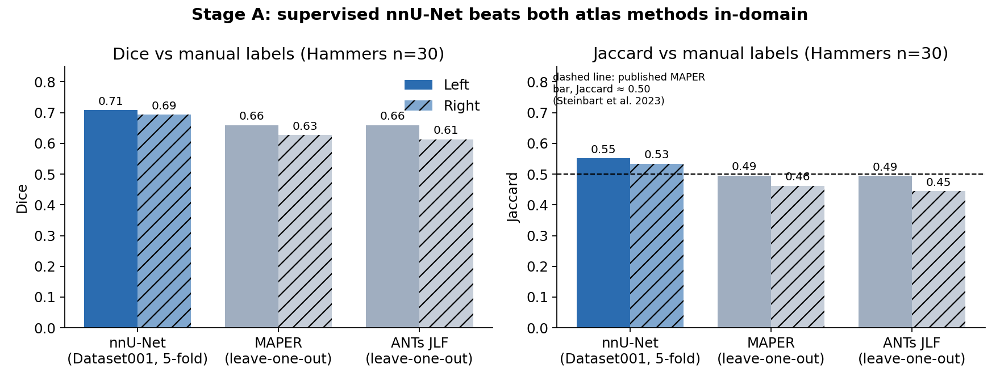

piriform-ai
===========

*Training deep-learning models to segment the piriform cortex on brain MRI:
theory, mathematics, code, and experiments.*

**Author:** Philbert Ndagijimana ·
`phindagiji@gmail.com <mailto:phindagiji@gmail.com>`__ ·
`github.com/phindagijimana <https://github.com/phindagijimana>`__

**piriform-ai** documents the complete process of building, training,
evaluating, and stress-testing segmentation models for the human **piriform
cortex (PC)**, a ~0.5 cm³ strip of olfactory cortex that matters in epilepsy
surgery and neurodegeneration. It covers supervised **nnU-Net** training,
classical **multi-atlas** baselines (MAPER, joint label fusion), a
**domain-shift** investigation across three cohorts, and **SynthSeg-PC**, a
model trained purely on synthetic images.

Every method choice is tied to the underlying theory and to a peer-reviewed
source, and every code walkthrough is pulled directly from the scripts in
``code/``, so the documentation cannot drift from the implementation.

.. note::

   This project handles data governed by data-use agreements (ADNI and a
   clinical epilepsy cohort). The repository contains **code, methods, and
   aggregate results only**. There are no images, labels, model weights,
   per-subject results, or subject identifiers.

At a glance
-----------

.. list-table::
   :header-rows: 1
   :widths: 40 60

   * - Question
     - Answer
   * - Can a supervised 3D U-Net learn PC from 30 labelled brains?
     - **Yes.** nnU-Net Dice 0.71 / 0.69 (L/R) vs MAPER 0.66 / 0.63 and JLF
       0.66 / 0.61 on the same held-out brains (:doc:`results`).
   * - Does it transfer to a second labelled site (ADNI)?
     - **No.** ADNI Dice stayed at 0.02–0.04. The branch was parked at a fail
       threshold set before the results (:doc:`theory/domain_shift`).
   * - Does it transfer to an unlabelled clinical cohort?
     - **Partly.** Only once the crop geometry and brain extraction matched
       training (:ref:`fov-geometry`, :ref:`intensity-fingerprint`).
   * - Does synthetic-image training remove the preprocessing dependence?
     - **Not yet.** It is the only model that produces non-empty masks without
       intensity matching, but it is below the 0.40 bar on Hammers
       (:doc:`theory/synthseg`).

   In-domain comparison on the Hammers atlas (n=30, each brain held out).

Short on time? Read :doc:`reviewers`. Otherwise start with :doc:`overview`;
the theory pages derive what the code does, and the programming pages walk
through it.

.. toctree::
   :maxdepth: 2
   :caption: Getting started

   reviewers
   overview
   literature
   workflows
   usage

.. _theory-toc:

.. toctree::
   :maxdepth: 2
   :caption: Theory and mathematics

   theory/segmentation
   theory/unet
   theory/losses
   theory/augmentation
   theory/multiatlas
   theory/synthseg
   theory/domain_shift
   theory/metrics

.. _programming-toc:

.. toctree::
   :maxdepth: 2
   :caption: Programming

   programming/dataset_preparation
   programming/nnunet_training
   programming/synthseg_training
   programming/inference
   programming/evaluation

.. toctree::
   :maxdepth: 2
   :caption: Experiments and results

   experiments
   training_dynamics
   results
   engineering

.. toctree::
   :maxdepth: 1
   :caption: Reference

   citing
   references
