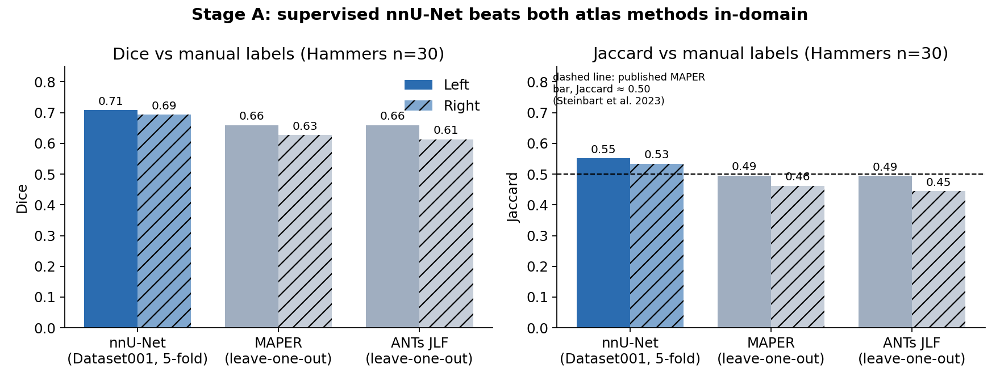
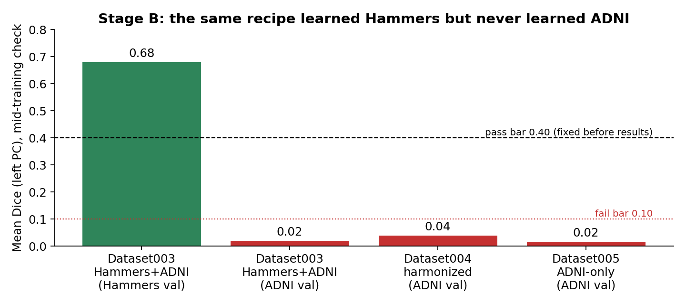

Results
=======

In-domain: Hammers n=30 (Final)
-------------------------------

.. list-table::
   :header-rows: 1

   * - Method
     - Dice L / R
     - Jaccard L / R
     - ASD L / R (mm)
     - \|ΔV\| L / R (mm³)
   * - **nnU-Net** (5-fold)
     - **0.708 / 0.693**
     - **0.551 / 0.534**
     - **0.57 / 0.56**
     - **75 / 82**
   * - MAPER (leave-one-out)
     - 0.659 / 0.627
     - 0.495 / 0.462
     - 0.66 / 0.70
     - 84 / 94
   * - JLF (leave-one-out)
     - 0.659 / 0.613
     - 0.494 / 0.445
     - 0.66 / 0.70
     - 150 / 171
   * - *Published MAPER bar*
     - —
     - *≈ 0.50*
     - —
     - —

   nnU-Net is better than both multi-atlas methods on every metric.
   Sub-millimetre ASD for all methods confirms that most of the remaining
   Dice error is a boundary effect (:ref:`thin-structure-dice`).

Second site: ADNI n=37 (Parked)
-------------------------------

   The same recipe learned Hammers but never learned ADNI.

.. list-table::
   :header-rows: 1

   * - Model
     - ADNI Dice
     - Hammers Dice
   * - Dataset003: Hammers + ADNI
     - ~0.02
     - ~0.68
   * - Dataset004: + harmonisation
     - ~0.04 (misplaced)
     - ~0.68
   * - Dataset005: ADNI only
     - 0.017 / 0.001
     - —
   * - Dataset002 with oracle crop
     - 0 (empty)
     - —
   * - SynthSeg-PC v1, atlas crop
     - 0 (crop missed)
     - 0.467

Clinical target cohort
----------------------

Results on the private clinical cohort are not reported here. Two qualitative
findings shaped the pipeline: the crop location mattered more than the model
(:ref:`fov-geometry`), and inference only worked when brain extraction matched
training (:ref:`intensity-fingerprint`).

Production
----------

Production segmentation uses JLF. No deep-learning model is deployed until one
is validated against manual labels on the target cohort.

Compute
-------

Stage A took about :math:`5 \times 47 \approx 235` GPU-hours on 24 GB MIG
slices. JLF took 11–16 CPU-minutes per brain.
