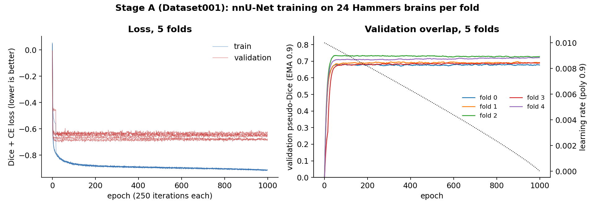
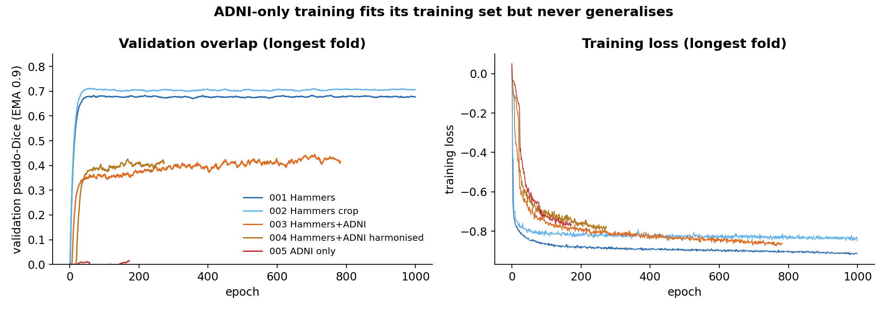
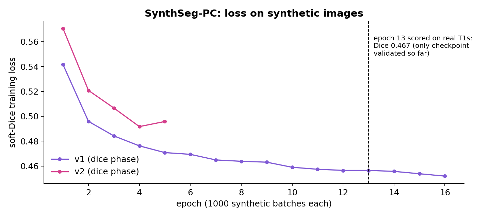

Training dynamics
=================

This page shows how each model actually trained: loss and validation overlap
per epoch, read from the training logs. The curves are produced by
``figures/extract_training_curves.py``, which keeps only per-epoch scalars,
and ``figures/make_figures.py``.

.. contents::
   :local:
   :depth: 1

What the curves measure
-----------------------

* **Loss.** nnU-Net minimises cross-entropy plus the *negative* soft Dice
  (:doc:`theory/losses`), so the loss is negative and lower is better. A
  perfect fit approaches :math:`-1`.
* **Pseudo-Dice.** At the end of each epoch nnU-Net runs 50 validation
  iterations on patches sampled like training patches (foreground
  oversampled), accumulates true positives, false positives and false
  negatives per class, and reports Dice. This is a cheap *proxy*, not the
  final metric. The final per-fold Dice comes from sliding-window inference on
  the full held-out volumes. For fold 0 of Dataset001 the two agree closely
  (pseudo-Dice 0.668 at epoch 1000, full-volume validation Dice 0.672).
* **EMA.** The plotted pseudo-Dice is smoothed with the same exponential
  moving average nnU-Net uses to pick ``checkpoint_best``:
  :math:`m_t = 0.9\,m_{t-1} + 0.1\,d_t`.

Stage A: nnU-Net on Hammers (Dataset001)
----------------------------------------

   Five folds, 1000 epochs × 250 iterations each. Left: training (blue) and
   validation (red) loss. Right: EMA pseudo-Dice per fold, with the
   polynomial learning-rate schedule (dotted).

What the curves show:

1. **Validation overlap saturates early.** Every fold reaches its plateau
   (pseudo-Dice 0.68–0.73) within roughly the first 100 epochs and stays
   flat while the learning rate decays from :math:`10^{-2}` to 0.
2. **The train–validation gap is in the loss, not the overlap.** Training
   loss keeps falling to about :math:`-0.91`; validation loss stays near
   :math:`-0.63` to :math:`-0.68` from about epoch 50 onwards. The extra
   training fit is mostly sharper, more confident boundaries on the 24
   training brains. It does not raise or lower validation Dice, so there is no
   harmful overfitting in the metric that matters.
3. **Fold spread is the real uncertainty.** The fold-to-fold range in
   validation Dice (about 0.05) is larger than any trend after epoch 100.
   With six validation brains per fold, this is the noise floor for
   comparing variants (:doc:`theory/metrics`).

Consequence: a much shorter schedule would very likely have given the same
validation Dice at a fraction of the roughly 235 GPU-hours. I kept nnU-Net's
default 1000 epochs so that Stage A is a faithful, unmodified baseline
:ref:`[Isensee 2021] <ref-isensee>`. For later variants the curves are the
evidence to cut the schedule.

Crop model (Dataset002)
-----------------------

The 60 mm crop model trains the same way and plateaus slightly higher
(pseudo-Dice 0.70–0.74), consistent with the ~60× higher foreground fraction
(:ref:`class-imbalance`). Two of the five folds converged to a visibly higher
training loss (about :math:`-0.84` vs :math:`-0.96`) with similar validation
Dice. I noticed this but did not investigate it, because it did not change any
decision.

Multi-site runs: what the training metric hid
---------------------------------------------

   Longest fold of each dataset variant. Left: EMA pseudo-Dice. Right:
   training loss.

* **Hammers + ADNI (Dataset003) and harmonised (Dataset004).** The pooled
  pseudo-Dice climbed slowly to about 0.4–0.5. Taken alone, that looks like a
  model that is learning, just more slowly. Scoring **per site** showed the
  truth: about 0.68 on Hammers and about 0.02 on ADNI
  (:doc:`results`). The pooled validation number averaged a working site with
  a failed one. Since then, every multi-site run is scored per site, and the
  pooled training metric is used only to check that training is running.
* **ADNI only (Dataset005).** The training loss fell to about :math:`-0.77`,
  close to the Hammers runs, while the validation pseudo-Dice stayed at or
  below about 0.04 for all 173 epochs. The network *can* fit the ADNI
  training brains; it does not generalise to held-out ADNI brains. That rules
  out "not enough capacity" or "not enough epochs" and points to the data
  (:doc:`theory/domain_shift`). The branch was parked at the fail threshold
  set before training (E4 in :doc:`experiments`).

SynthSeg-PC
-----------

   Soft-Dice training loss on synthetic images, per epoch of 1000 batches.
   The one-epoch weighted-L2 warm-up (loss ≈ 13, a different scale) is not
   shown.

* **v1** drops quickly over the first 5 epochs and is nearly flat after
  epoch 10 (0.459 at epoch 10, 0.452 at epoch 16).
* **v2** uses a harder generator (stronger deformation and bias field), so
  its loss is higher at the same epoch. Losses from different generators are
  not comparable, because each recipe defines a different training
  distribution.
* The synthetic loss says nothing about real images. That is why the
  checkpoint is chosen by Dice on **real** Hammers T1s
  (:ref:`epoch-selection`). So far only the epoch-13 checkpoint has been
  scored on real images (Dice 0.467); a full per-epoch sweep is part of the
  paused next steps (E10).

Lessons for training practice
-----------------------------

* Read the curves before adding epochs or capacity. Here the plateau came
  early and the limiting factor was data, not optimisation.
* A pooled validation metric can hide a total failure on one subgroup. Score
  per site (or per subgroup) from the first run.
* "Training loss falls, validation stays at zero" is a diagnosis: the model
  fits but does not transfer. Look at the data before tuning the network.
* For synthetic-data training, the training loss only shows that the
  optimiser is working. Model selection needs real labelled images.
